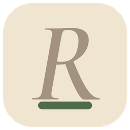

# Rustinho

Sistema para loja de autopeças: balcão de vendas, estoque, compras pelo XML da NF-e, caixa, crediário, financeiro, trocas e devoluções, ordem de serviço (oficina), etiquetas com código de barras, painel e backup no Google Drive. Vários caixas trabalham juntos pelo Wi-Fi e continuam vendendo sem internet.

Feito em **Rust** (regras e banco de dados) com **Qt 6 / QML** (telas). Código livre, licença **MIT**.

## Baixar

Na página [**Releases**](https://github.com/nrenanjo/Rustinho/releases), na versão mais nova:

| Sistema | Arquivo |
|---|---|
| Windows 10 e 11 (64 bits) | `Rustinho-…-Windows-instalador.exe` |
| Linux (64 bits) | `Rustinho-…-Linux-x86_64.AppImage` |

**Windows:** abra o instalador e vá em Avançar até Concluir. Como o instalador não tem assinatura paga, o Windows pode mostrar "O Windows protegeu o computador": clique em **Mais informações → Executar assim mesmo**.

**Linux:** dê permissão de execução e abra:

    chmod +x Rustinho-*.AppImage
    ./Rustinho-*.AppImage

## Primeira vez

1. Nome da loja, nome deste computador (ex.: Caixa 1) e o seu usuário com senha.
2. Em **Configurações → Loja**, preencha o CNPJ e o estado.
3. Em **Configurações → Backup**, crie a senha do backup (anote num papel) e, se quiser, conecte o Google Drive.
4. Outros caixas: na primeira vez, escolha **"Já uso o Rustinho em outro caixa da loja"** e use a mesma senha da rede.

O [**Manual**](MANUAL.md) explica cada parte.

## Compilar

Precisa de Rust (stable) e Qt 6 (qtbase e qtdeclarative).

    ./compilar.sh      # Linux: mostra o que falta instalar, compila e deixa ./rustinho
    cargo test -p rustinho-nucleo

A cada envio para a `main`, o GitHub monta o instalador do Windows e o AppImage sozinho (`.github/workflows/montar.yml`). Uma etiqueta `vX.Y.Z` publica os dois em Releases.

## Organização

- `nucleo/`: regras da loja e banco de dados (SQLite), sem interface. Tudo testável com `cargo test`.
- `app/`: as telas (`qml/`), a ponte com o núcleo (`src/`), impressão em PDF (`cpp/`) e as fontes (`fontes/`, licença OFL).
- `instalador/`: instalador do Windows (Inno Setup), ícone e atalho do Linux.

## Licença

[MIT](LICENSE). As fontes (Cormorant Garamond, Source Sans 3 e Source Serif 4) têm licença OFL, em `app/fontes/LICENCAS/`. O rclone, que vai junto nos instaladores, é MIT.
