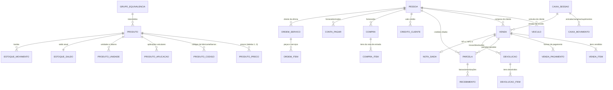

# Modelo de Dados e Esquema SQLite (Migrações 0001 a 0023) — Rustinho 0.9.17

> Gerado pelo Reversa (Data Master) em 2026-11-02
> Extraído da leitura integral das 23 migrações em `nucleo/src/migracoes/0001_inicial.sql` a `0023_rascunho_e_pendencias.sql` (`VERSAO_ATUAL = 23`).

---

## 1. Visão Geral do Banco (`rustinho.db`)

- **Motor:** SQLite 3 embarcado (`rusqlite` 0.40 bundled), operando em `journal_mode = WAL`, `synchronous = NORMAL`, `foreign_keys = ON`, `busy_timeout = 5000`.
- **Controle de Versão:** `PRAGMA user_version = 23` + tabela `_migracoes`.
- **Funções SQL Customizadas Registradas em `banco.rs`:**
  - `normalizar(texto)` — remoção de acentos e conversão para minúsculas para busca textual;
  - `rustinho_id()` — geração de UUIDv7 em gatilhos SQL;
  - `rustinho_agora()` — timestamp atual;
  - `rustinho_operacao()` — chave da operação ativa;
  - `rustinho_historia(tabela, chave, acao)` — gravação condicional na tabela `historia` para sincronização.

---

## 2. Diagrama Entidade-Relacionamento (ERD Principal)

---

## 3. Catálogo de Tabelas por Domínio (Esquema v23)

### 3.1. Catálogo de Peças e Estoque
| Tabela | Chave Primária | Migração de Origem / Alterações | Papel |
|---|---|---|---|
| `produto` | `id TEXT` | `0001`, `0003`, `0018`, `0023` | Cadastro mestre de peças (`codigo_interno`, `codigo_fabricante`, `gtin`, `nome`, `nome_normalizado`, `marca`, `unidade`, `custo_medio`, `estoque_minimo`, `estoque_maximo`, `ncm`, `cest`, `cfop_padrao`, `cst_padrao`, `csosn_padrao`, `origem_mercadoria`, `ativo`, `rascunho`). |
| `produto_preco` | `(produto_id, tabela)` | `0001` | Tabelas de preço 1 (balcão), 2 (oficina/atacado) e 3 (especial) em centavos (`preco INTEGER`). |
| `produto_codigo` | `id TEXT` | `0001` | Códigos auxiliares/barras alternativos da peça. |
| `produto_aplicacao` | `id TEXT` | `0001` | Aplicação por montadora, modelo, motor e intervalo de anos (`ano_inicio`, `ano_fim`). |
| `grupo_equivalencia` | `id TEXT` | `0001` | Agrupador de peças intercambiáveis. |
| `produto_unidade` | `(produto_id, unidade)` | `0003` | Unidades alternativas de compra/venda e fator de conversão (`fator INTEGER`). |
| `estoque_saldo` | `produto_id TEXT` | `0001`, `0018` | Saldo físico atual (`quantidade`, `quantidade_mili`, `reservado`). |
| `estoque_movimento` | `id TEXT` | `0001`, `0018` | Kardex completo de entradas, saídas, ajustes, estornos e inventários. |
| `inventario` / `inventario_item` | `id TEXT` | `0001` | Sessões de contagem física de estoque e divergências apuradas. |

### 3.2. Comercial: Vendas, Caixa, Orçamentos, Devoluções e Encomendas
| Tabela | Chave Primária | Migração de Origem / Alterações | Papel |
|---|---|---|---|
| `caixa_sessao` | `id TEXT` | `0001`, `0016` | Abertura e fechamento de gaveta (`abertura`, `esperado`, `contado`, `diferenca`, `computador_id`). |
| `caixa_movimento` | `id TEXT` | `0001` | Movimentações em espécie (`entrada`, `saida`, `suprimento`, `sangria`). |
| `venda` | `id TEXT` | `0001`, `0005`, `0012`, `0015`, `0020` | Cabeçalho de venda (`numero`, `sessao_id`, `cliente_id`, `vendedor_id`, `subtotal`, `desconto`, `total`, `situacao`, `cancelado_apos_fechar`). |
| `venda_item` | `id TEXT` | `0001`, `0005`, `0018` | Itens vendidos com `custo_unitario` congelado na venda e `quantidade_mili`. |
| `venda_pagamento` | `id TEXT` | `0001` | Meios de pagamento da venda (`dinheiro`, `pix`, `debito`, `credito`, `crediario`, `cheque`, `credito_cliente`). |
| `orcamento` / `orcamento_item` | `id TEXT` | `0001`, `0018` | Cotações prévias e seus itens. |
| `devolucao` / `devolucao_item` | `id TEXT` | `0001`, `0018` | Devoluções/trocas vinculadas à venda original (`forma_reembolso`, `volta_estoque`). |
| `credito_cliente` / `credito_movimento` | `id TEXT` | `0001` | Saldo e histórico de vale-crédito de clientes oriundos de trocas. |
| `encomenda` | `id TEXT` | `0001`, `0013` | Pedidos sob encomenda de peças indisponíveis. |

### 3.3. Compras, Financeiro, Pessoas, Oficina e Fiscal
| Tabela | Chave Primária | Migração de Origem / Alterações | Papel |
|---|---|---|---|
| `compra` / `compra_item` | `id TEXT` | `0001`, `0004`, `0018`, `0022` | Notas fiscais de entrada, chave NF-e de 44 dígitos, XML bruto assinado e itens vinculados. |
| `parcela` / `recebimento` | `id TEXT` | `0001`, `0010` | Contas a receber (crediário) e histórico de amortizações. |
| `conta_pagar` / `conta_pagar_pagamento` | `id TEXT` | `0001`, `0006`, `0008`, `0010` | Contas a pagar, despesas fixas/variáveis, categorias DRE e baixas. |
| `conta_loja` / `transferencia_loja` | `id TEXT` | `0010` | Contas financeiras da loja (cofre, bancos, carteira de cheques) e transferências. |
| `cheque` | `id TEXT` | `0009`, `0010` | Controle de cheques recebidos (`em_maos`, `depositado`, `compensado`, `devolvido`, `repassado`). |
| `pessoa` / `veiculo` | `id TEXT` | `0001`, `0023` | Clientes, fornecedores e frota de veículos vinculados. |
| `ordem_servico` / `ordem_item` | `id TEXT` | `0001` | Ordens de serviço da oficina mecânica. |
| `nota_saida` / `regra_st` | `id TEXT` | `0007`, `0021` | Rascunhos/emissões de NF-e de saída e regras de Substituição Tributária por NCM/UF. |

### 3.4. Segurança, Auditoria e Sincronização
| Tabela | Chave Primária | Migração de Origem / Alterações | Papel |
|---|---|---|---|
| `usuario` | `id TEXT` | `0001`, `0002` | Operadores (`gerente`, `caixa`) e hash Argon2id da senha. |
| `auditoria` | `id TEXT` | `0014` | Trilha imutável de ações sensíveis e liberações de supervisão. |
| `operacao_feita` | `chave TEXT` | `0019` | Tabela de idempotência (`FALHA-04`) dos comandos em `NAO_REPETIR`. |
| `computador` / `faixa_codigo` | `id TEXT` | `0016`, `0017` | Identidade criptográfica dos caixas pareados e faixas de numeração. |
| `historia` / `conflito_sync` | `seq INTEGER` / `id TEXT` | `0016` | Log de eventos de replicação LAN e fila de divergências entre caixas. |
| `config` / `pendencia_importacao` | `chave TEXT` / `id TEXT` | `0001`, `0023` | Parâmetros chave-valor da loja e fila persistida de pendências pós-importação. |

