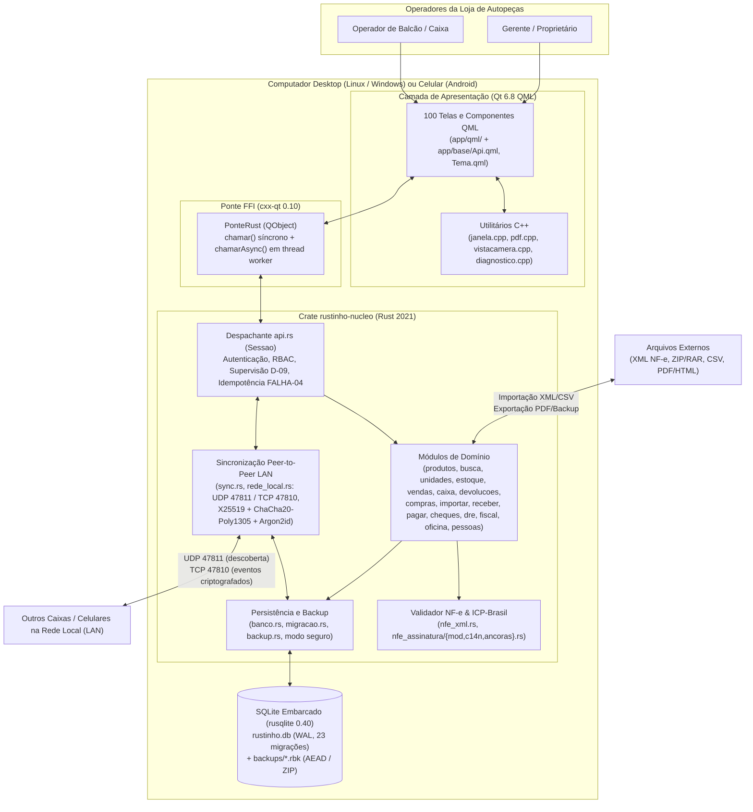

# Visão Geral da Arquitetura (C4 & Fluxos) — Rustinho 0.9.17

> Gerado pelo Reversa (Arquiteto) em 2026-11-02
> Extraído de `Cargo.toml`, `nucleo/src/`, `app/`, `android/`, `instalador/` e `.github/workflows/`.

---

## 1. Diagrama de Contexto e Contêineres (C4)

---

## 2. Fluxo de Chamada de Comandos (`QML → PonteRust → api.rs → SQLite`)

1. **Interface QML (`app/base/Api.qml`):**
   - Chamadas de leitura rápidas usam `Api.chamar(comando, dados)` (síncrono via `PonteRust::chamar`).
   - Operações de escrita ou pesadas usam `Api.chamarAsync(comando, dados, callback)`, gerando ou preservando `chaveOperacao` (UUIDv4/v7) para comandos mutáveis.
2. **Fila Assíncrona (`app/src/ponte.rs`):**
   - Uma thread dedicada consome pedidos `(id, comando, dados)` via `std::sync::mpsc`, chama `Sessao::chamar` na conexão SQLite dedicada ao worker e emite o sinal Qt `respostaPronta(id, json)` de volta à thread GUI.
3. **Despachante Central (`nucleo/src/api.rs`):**
   - Verifica se o banco está em `somente_leitura` (Modo Seguro): se estiver, recusa todos os comandos fora da lista de leitura/recuperação.
   - Verifica se o comando está em `NAO_REPETIR` (52 comandos): exige `chaveOperacao` não vazia, abre transação SQLite (`SAVEPOINT`), consulta `operacao_feita` e, se já executada, devolve a resposta gravada sem repetir o efeito colateral.
   - Verifica permissões do usuário logado (`gerente` vs `caixa`) e consome ou valida o token de supervisão (`Supervisao` em memória) quando exigido.
   - Executa o módulo de domínio correspondente e grava trilha em `auditoria` e eventos de replicação em `historia` (via gatilhos SQLite).

---

## 3. Topologia de Sincronização em Rede Local (`sync.rs` e `rede_local.rs`)

- **Descoberta:** Broadcast UDP na porta `47811` a cada ciclo anunciando `computador_id`, `loja_id` (ou estado de pareamento) e porta TCP `47810`.
- **Segurança de Transporte:**
  - Chave simétrica derivada da `senha_rede` via `Argon2id` com sal fixo de protocolo.
  - Handshake TCP efêmero `X25519` autenticado com `ChaCha20Poly1305` (incluindo proteção contra replay e rate-limiting por IP em `rede_local.rs`).
- **Modelo de Replicação:**
  - Gatilhos SQLite nas 31 tabelas sincronizáveis registram cada `INSERT`, `UPDATE` e `DELETE` na tabela `historia` com relógio lógico/timestamp e `computador_id`.
  - No recebimento (`sync::aplicar_evento`), aplica resolução determinística de conflitos (Last-Write-Wins por timestamp/ID para cadastros, união JSON para `config`, e detecção de conflitos de vendas concorrentes com saldo insuficiente em `conflito_sync`).

